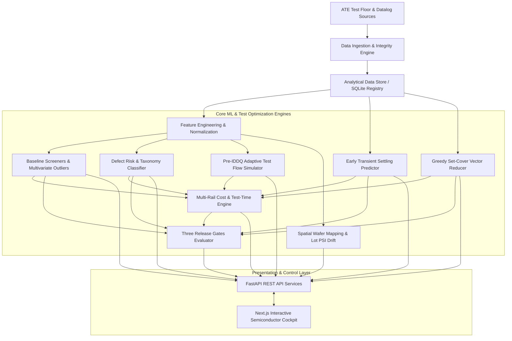

# System Architecture & Technical Design

**Project:** IDDQ AI Optimization Platform  
**Document:** System Architecture & Data Pipelines  
**Date:** 2026-10-31  

---

## 1. System Overview

The IDDQ AI Optimization Platform is an enterprise semiconductor test engineering application designed to analyze quiescent current (IDDQ) measurements, detect subtle physical defects against elevated background leakage, and safely reduce ATE test times through six synergistic AI/ML optimization levers.

---

## 2. Component Design

### 2.1 Backend Architecture (`backend/`)
- **`app/main.py`**: ASGI root application with CORS, structured logging, global exception handling, and health endpoints.
- **`app/api/`**: REST API routers partitioned by functional module:
  - `/api/projects`: Project metadata, workspace association, dataset assignment.
  - `/api/datasets`: CSV upload, schema verification, sample preview, data-readiness checklist.
  - `/api/analyses`: Orchestrates analysis runs, baseline screening, defect classification, settling prediction, vector set cover, and adaptive flows.
  - `/api/die`: Die search by UID or wafer coordinate tuple, signature vector radar/curves, and local neighborhood evidence.
  - `/api/wafer`: 28×28 wafer coordinate map payloads, spatial clustering, and multi-wafer comparisons.
  - `/api/models`: Model registry, feature schema lineage, approval status, and rollback controls.
  - `/api/reports`: Markdown/HTML/CSV downloadable engineering summaries and audit trails.
- **`iddq/`**: Domain-specific pure-Python / NumPy / Scikit-learn test engineering core:
  - `ingestion/`: Safe multipart streaming CSV ingestion with SHA-256 checksums and immutable storage.
  - `validation/`: Schema type validators, join referential integrity, and lot partition compliance.
  - `features/`: Derived summary statistics, step detection, process-normalized residuals, and spatial KD-Tree NNR.
  - `baselines/`: Legacy 450 µA threshold, Max/Min current ratio, Delta-IDDQ, robust Mahalanobis distance, and Isolation Forest.
  - `defect_detection/`: Gradient Boosted Trees binary defect classifier and 5-class physical taxonomy predictor with class weighting.
  - `settling/`: Physics-informed dual-exponential regression and Quantile Gradient Boosting for early-termination guard-banding.
  - `vector_selection/`: Time-weighted greedy set-cover on 2,000 fault sites with held-out LOT11–12 verification.
  - `adaptive_testing/`: Pre-IDDQ feature risk scorer, random full-test audit loop, unfamiliar data fallback, and escape simulator.
  - `spatial/`: 28×28 circular wafer coordinate geometry, 8-neighbor NNR, and Population Stability Index (PSI) drift tracking across lots.
  - `flow_ordering/`: Time-weighted fallout ordering to minimize expected test time to first failure.
  - `cost_model/`: Transparent multi-rail timing model ($T_{IDDQ}$) and net economic cost-benefit equation.
  - `evaluation/`: Release Gates 1, 2, and 3 evaluators, confusion matrices, ROC/PR curves, and calibration metrics.
  - `governance/`: Immutable model card registration, lineage logging, and rollback mechanisms.

### 2.2 Frontend Architecture (`frontend/`)
- **Framework:** Next.js 15 (App Router) + React 19 + TypeScript.
- **Styling:** Tailwind CSS with an engineering design system:
  - Deep semiconductor slate background (`#0B0F17`, `#111827`) with high-contrast neutral slate panels (`#1F2937`).
  - Semiconductor status accents: Silicon Emerald (`#10B981`) for passing gates, Amber (`#F59E0B`) for drift warnings, Ruby (`#EF4444`) for confirmed defects, and Sapphire (`#3B82F6`) for active vectors.
- **Navigation Structure:**
  - `/dashboard`: High-level executive KPI cockpit with real-time screen performance, defect mix, test-time savings, and gate status.
  - `/datasets`: File upload, dataset validation progress, preview, and data-readiness checklist.
  - `/baseline-screens`: Interactive screen comparison (Legacy 450 µA, Current Ratio, Delta-IDDQ, Mahalanobis, Isolation Forest) with ROC curves and confusion matrices.
  - `/die-analysis`: Deep-dive die investigation search with vector-by-vector curves, radar comparison with normal reference die, and spatial neighborhood.
  - `/wafer-analysis`: Interactive 28×28 wafer map canvas with color modes (Raw Current, Normalized Residual, Risk, Ground Truth) and lot-by-lot PSI drift charts.
  - `/settling-prediction`: Waveform inspection, sample cutoff selector ($k=3, 5, 10$), prediction intervals, and tester wait-time savings.
  - `/vector-optimization`: Greedy set-cover progression curves, coverage vs. time trade-offs, and held-out LOT11–12 escape audit.
  - `/adaptive-testing`: Pre-IDDQ risk threshold tuning, random audit fraction slider, and flow allocation simulation.
  - `/validation-gates`: Formal evaluation cockpit for Gate 1 (Data Foundation), Gate 2 (Coverage & Overkill), and Gate 3 (Shadow Mode Escapes).
  - `/reports`: Exportable engineering reports and audit lineage log.

---

## 3. Database Schema (`backend/app/database/models.py`)

SQLite database managed via SQLAlchemy with tables:
- `projects`: `id`, `name`, `description`, `created_at`.
- `datasets`: `id`, `project_id`, `file_type`, `filename`, `file_path`, `row_count`, `checksum_sha256`, `status`, `readiness_json`, `created_at`.
- `analysis_runs`: `id`, `project_id`, `dataset_id`, `name`, `status`, `parameters_json`, `results_json`, `created_at`, `completed_at`.
- `model_registry`: `id`, `model_type`, `version`, `feature_names_json`, `metrics_json`, `artifact_path`, `is_active`, `approval_status`, `created_at`.
- `gate_evaluations`: `id`, `analysis_run_id`, `gate_id`, `status` (`passed`, `failed`, `blocked`), `evidence_json`, `evaluated_at`.
- `audit_logs`: `id`, `event_type`, `entity_type`, `entity_id`, `details_json`, `timestamp`.

---

## 4. Anti-Leakage & Safety Guard-Bands

To prevent methodological and operational test escape risks:
1. **Feature Leakage Prevention:** Feature extraction pipelines strictly reject `true_defect`, `defect_type`, `defect_fault_id`, `defect_current_ua`, `fixed_limit_fail`, `final_test_fail`, `burn_in_fail`, and `field_return` from model matrices.
2. **Pre-IDDQ Adaptive Testing Integrity:** The adaptive classifier operates strictly on parametric results available before vector apply (`ring_osc_mhz`, `fmax_mhz`, `vmin_v`, `leak_monitor_ua`, wafer coordinates).
3. **Partition Boundary Integrity:** Transformations (standardizers, robust scalers, residual regressors) are fit solely on training lots (`LOT01`–`LOT08`) and transformed forward onto validation (`LOT09`–`LOT10`) and test (`LOT11`–`LOT12`).
4. **Safety Fallback Triggers:** Full ATE test execution is automatically mandated if:
   - Any pre-IDDQ parametric feature is missing or null.
   - Spatial coordinates fall outside normal wafer bounds.
   - The die is randomly selected as part of the random audit fraction (configurable default: 5%).
   - The settling prediction confidence interval width exceeds measurement repeatability limits.
   - Lot drift PSI exceeds 0.25 (process shift alert).
